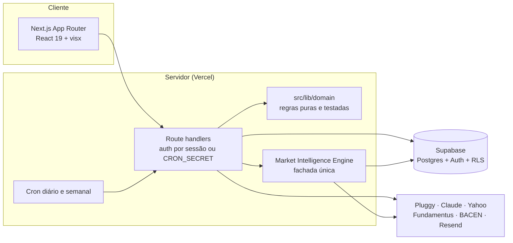

<p align="center">
  
</p>

<p align="center">
  <b>Copiloto de investimentos com IA para o investidor brasileiro.</b><br/>
  Consolida o patrimônio via Open Finance, projeta o longo prazo, conversa em linguagem natural<br/>
  e transforma notícias de mercado em sinais mensuráveis sobre ações da B3.
</p>

<p align="center">
  
  
  
  
  
  
</p>

---

## Sobre o projeto

O PRUMO nasceu de uma pergunta simples: **"onde eu chego daqui a 10 anos, e o que muda se eu ajustar hoje?"**

É um produto completo construído e usado no dia a dia por uma pessoa: conecta bancos e
cartões por Open Finance, calcula renda fixa com a precisão do mercado brasileiro, mantém
um histórico diário do patrimônio, manda um resumo do cartão por e-mail toda manhã e
tem um copiloto de IA que consulta a carteira e uma engine própria de inteligência de mercado.

> Projeto pessoal e educacional; não é recomendação de investimento.

## Sobre este repositório

Esta é a **versão pública** do PRUMO: a interface completa, as regras financeiras e os
testes, rodando em **modo demo** com uma carteira fictícia. O app real vive num
repositório privado, e algumas partes ficam só lá:

| Na versão pública | Só na versão privada |
|---|---|
| Todas as telas (desktop e mobile), dashboard, projeções, metas, orçamento, cartões, histórico, ações | Engine de inteligência de mercado (coleta, extração com IA, scoring, backtest) |
| Regras financeiras em `src/lib/domain` com testes | Prompt, ferramentas e contexto do Copiloto |
| Acesso a dados (`src/lib/supabase`) e cotações públicas | Integração com Open Finance (Pluggy), e-mails e rotinas agendadas |

No modo demo, o Supabase é trocado por um banco em memória com dados fictícios
([`src/lib/demo`](src/lib/demo)) que implementa a mesma API encadeável do cliente
Supabase. As telas não sabem a diferença; o que o visitante altera fica salvo só no
navegador dele. Onde a tela depende de um módulo privado, aparece um aviso no lugar.

## Destaques

**Copiloto com tool-use.** Chat em streaming com Claude que chama ferramentas do próprio
app: analisa a carteira, consulta oportunidades e eventos da engine de mercado, compara
ativos e guarda uma **memória de longo prazo** sobre o usuário. O contexto da carteira é
montado no servidor a partir do banco (via RLS), nunca confiando em texto vindo do cliente,
e o prompt é dividido em bloco estático e volátil para aproveitar **prompt caching** entre
rodadas de ferramenta.

**Market Intelligence Engine.** Pipeline em três etapas (`collect` → `score` → `digest`):
coleta notícias, extrai eventos estruturados com LLM, mapeia cada evento para ativos da
B3, calcula um *Opportunity Score* e registra as previsões num ledger para **backtest de
acurácia** depois. Também mede como cada ativo reagiu historicamente a fatores externos
(petróleo, dólar, juros dos EUA, VIX) e usa essa matriz como evidência.

**Carteiras recomendadas com nota ex-ante.** Coleta carteiras públicas de casas de
análise e dá a cada uma uma nota de 0 a 100 por pilares (qualidade, valuation, risco,
renda, liquidez, diversificação), com dados do Fundamentus e do Yahoo Finance.

**Finanças brasileiras de verdade.** Renda fixa em base 252 dias úteis com calendário
ANBIMA, IR regressivo e isenção de LCI/LCA; rentabilidade *money-weighted* (XIRR)
comparada com CDI e Ibovespa aplicando os mesmos fluxos de caixa; reconstrução de
parcelas que o Open Finance não entrega na fatura aberta.

**Rotina diária automatizada.** Um único cron encadeia sync do Open Finance → snapshot
do patrimônio → e-mail com o resumo do cartão (com gráficos renderizados no servidor,
porque o Gmail descarta SVG) → atualização das carteiras recomendadas. Cada etapa é
isolada: uma falha no banco não deixa o dia sem e-mail, e o sync tem orçamento de tempo
próprio para caber no limite da função serverless.

## Arquitetura



- **Server-first.** Toda integração externa fica atrás de `import "server-only"`; o
  navegador só fala com as rotas do próprio app.
- **Domínio puro.** Cálculos financeiros vivem em `src/lib/domain`, sem I/O, e são
  cobertos por testes.
- **Bounded context.** A engine de mercado (`src/lib/market-intelligence`) expõe uma
  fachada única em `index.ts`; o resto do app não conhece os detalhes internos.
- **Segurança.** Row Level Security em todas as tabelas (`user_id = auth.uid()`), rotas
  de API com sessão obrigatória, crons protegidos por segredo comparado em tempo constante
  e chave de serviço usada só nos jobs agendados.

## Stack

| Camada | Tecnologias |
|---|---|
| Front-end | Next.js 16 (App Router), React 19, TypeScript, Tailwind CSS 4, shadcn/ui, visx |
| Back-end | Route handlers do Next.js, Vercel Cron, `next/og` para imagens de e-mail |
| Dados | Supabase (Postgres, Auth, RLS) |
| IA | Claude via `@anthropic-ai/sdk` (streaming, tool-use, prompt caching) |
| Integrações | Pluggy (Open Finance), Yahoo Finance, Fundamentus, BACEN SGS, brapi, Google News RSS, Resend |
| Qualidade | Vitest, ESLint, `tsc --noEmit` e build no CI (GitHub Actions) |

## Estrutura

```
src/
  app/            páginas e rotas de API (App Router)
  components/     UI (desktop e mobile)
  lib/
    domain/       regras financeiras puras + testes
    supabase/     acesso a dados (tipado pelo schema do Postgres)
    demo/         banco em memória e dados fictícios do modo demo
    market/       cotações e indicadores (brapi, BACEN)
    server/       autenticação das rotas de API
```

## Rodando localmente

Pré-requisito: Node 22. Nenhuma chave é necessária para o modo demo.

```bash
npm install
npm run dev     # http://localhost:3000
npm test        # Vitest
npm run lint
```

`BRAPI_TOKEN` é opcional: sem ele, as cotações da B3 usam o limite gratuito da brapi.

## Como foi construído

O produto foi guiado por mim e boa parte do código foi escrita em par com o
[Claude Code](https://claude.com/claude-code), com revisão, testes e CI em cada mudança.
